# Marvis 深度实测：当 AI Agent 真正进入电脑操作层

> 从模糊找文件到多步骤自动化，我用三组真实任务检验“24 小时 AI 管家”。

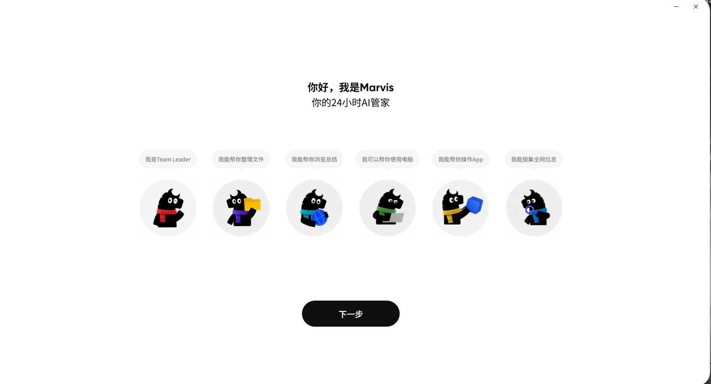

**作者：** Acparrot 
**测试时间：** 2026 年 9 月 27—29 日 
**作品类型：** 独立产品实测 / AI 技术内容样本

## 创作思路：不列功能，而是找到“为什么要用”

这次测评先从产品定位出发：Marvis 的核心不只是 AI Agent，而是“管家”。因此，内容没有从参数或功能清单起笔，而是把“管家”拆成两个用户可感知的问题：它是否能理解电脑里的信息？它是否能代替用户完成那些贯穿一天、琐碎却无法回避的操作？

**内容结构**采用“痛点钩子 → 简单案例 → 综合任务 → 使用边界 → 价值回答”的递进关系。先用模糊找文件证明它“懂电脑内容”，再用学习资料整理检验多步骤任务，最后用游戏准备、系统诊断和本地模式补足跨应用能力、权限确认和隐私边界。

**案例选择**遵循从简单到复杂、从单点能力到真实工作流的顺序。模糊检索、资料整理和电脑任务分别回答“它能不能找到”、“它能不能完成”和“它能不能让人放心交给它”。这种安排不只展示产品亮点，也保留了执行偏差和未验证项。

**最终价值**落在日常生活中“小而繁琐，但重要且必须完成”的任务上。我想回答的不是“Marvis 的功能有多强”，而是“它在什么时候真的能为普通用户省下注意力”。

## 文案版本：从初稿到发布稿

> [!IMPORTANT]
> 本项目完整保留了文案的版本演进。V1 展示最初的内容判断，V2 展示口语节奏与结构优化，作品集发布版则进一步校正了证据边界和未验证表述。

### 📄 [文案初稿 V1](docs/文案初稿-v1.md)

保留首轮选题切入、案例顺序和生活化表达，可用于对照后续的节奏与结构调整。

### 🎙️ [文案 V2｜口播逐字稿](docs/文案_v2+逐字稿.md)

完整口播逐字稿，按原稿保留。

### ✅ [作品集发布版](docs/video-script.md)

面向公开作品集的最终编辑版，补入测试等级、失败点、证据充足度与画面建议。

## 先说结论

Marvis 最有价值的地方，不是“会聊天”，而是它能把自然语言变成本地文件、应用和系统操作。实测中，它能根据模糊记忆找到本地资料，也能拆解“收集—归类—总结—定时打开”这类多步骤任务。

但它还不是一个可以完全放手不管的“全自动管家”：生成结果的存放位置、定时任务的反馈方式、高风险操作的人工确认，都会影响任务是否真正闭环。本地模式在这次测试中也没有完成从安装到断网使用的端到端验证。

## 官方说它能做什么

Marvis 官网将产品定位为“你的 24 小时 AI 管家”，并列出了本地文件理解、手机连接电脑、系统设置以及本地模式等能力。腾讯生态产品页则将其概括为“操作系统级桌面 AI 助手”。

> 下文会严格区分三种信息：**官方能力说明**、**本次实测观察**与**作者分析**。官方介绍不直接等于本次已验证。

## 我怎么测

这次没有把单一功能的“能不能点开”当作深度测评，而是设计了三组连续任务：

1. **模糊记忆找文件**：不给准确文件名和路径，只描述资料讲了什么。
2. **学习资料工作流**：让它处理来自聊天软件的课件、笔记和课堂照片，完成分类、总结、存放与定时打开。
3. **系统与应用任务**：尝试提前准备游戏、读取硬件并提供优化建议，同时查看本地模式的启用条件。

| 项目 | 测试环境 |
| --- | --- |
| 操作系统 | Windows 11 |
| 硬件 | Intel Core i5-12600KF、RTX 4060、32GB 内存 |
| 测试时间 | 2026-09-27 至 2026-09-29 |
| 客户端版本 | 未记录；结论仅代表当时体验 |
| 方法 | 黑盒任务测试 + 过程截图 + 结果复核 |

## 结果总表

| 测试项 | 结果 | 关键观察 |
| --- | --- | --- |
| 模糊描述检索本地资料 | ✅ 成功 | 找到了与“大学生市场”相关的多份资料，并提炼出项目暂停原因 |
| 文件名与内容无关时的定位 | ✅ 成功 | 能从文件内容和历史线索入手，但“历史对话”与“本地文件”会出现不同回答路径 |
| 资料分类、摘要与定时打开 | ⚠️ 部分成功 | 分类、摘要和定时任务完成，但总结文件首先落在 C 盘工作区，提醒反馈也不够明确 |
| 启动游戏与硬件诊断 | ⚠️ 部分成功 | 能读取配置、启动游戏并输出建议；部分优化仍需手动确认或执行 |
| 手机远程操作 | 🔎 证据不完整 | 本次保留任务派发尝试，但没有足够的跨端界面证据支撑完整验证 |
| 本地模式 / 离线隐私 | ⏸️ 未完成闭环 | 进入了组件安装与硬件检查阶段，未完成断网运行和“文件 0 上传”的独立验证 |

## 场景一：不记得文件名，还能找到吗？

我先问了一个刻意模糊的问题：

> “我们之前是不是讨论过大学生市场？最后为什么没做？”

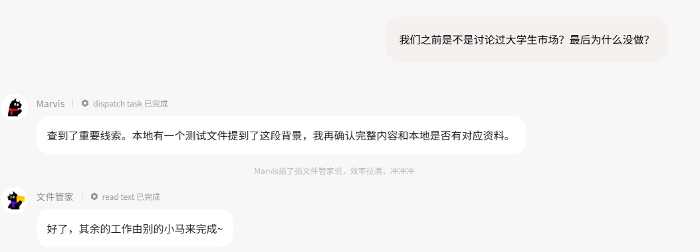

Marvis 没有把“找不到对话记录”当成终点，而是继续在本地找到了一组与提问语义吻合的时间线资料。

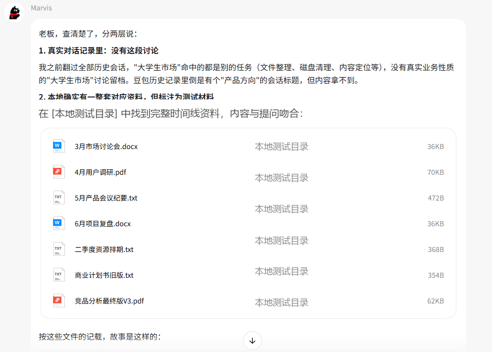

它进一步从不同月份的记录中提取了项目进度，并把“获客成本过高、付费意愿不足”概括为没有继续推进的原因。

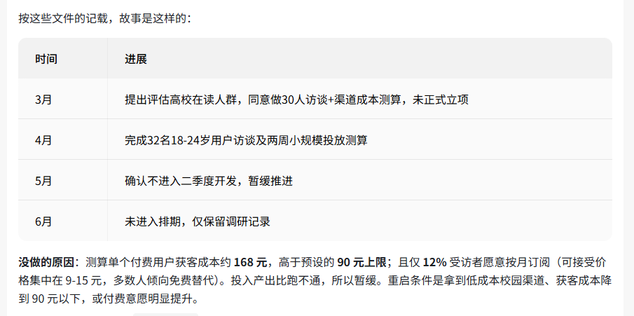

第二次我连文件名都不提供，只说自己记得一份“为什么休息也会像完成任务”的资料。Marvis 仍定位到了目标文件，还读取了其中的核心观点。

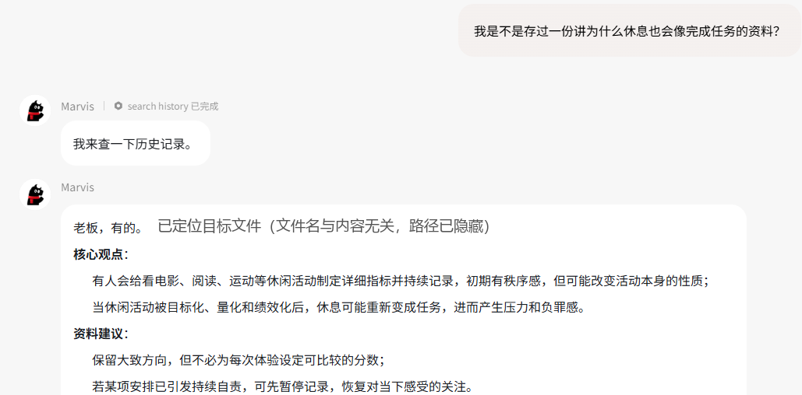

值得注意的是，换成“我在哪里讲过”后，它会优先检索对话历史，回答也随之改变。这说明对普通用户来说，“找电脑里的文件”和“找以前的对话”虽然听起来相似，但 Agent 选择的数据源并不相同。

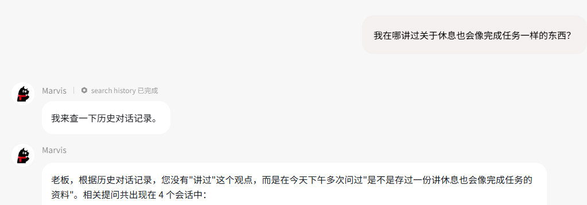

**本场景结论：** 对于“不记得文件放哪、也不记得叫什么”的情况，内容级检索比传统文件名搜索更接近用户的真实记忆方式。但界面应更明确地告诉用户，当前回答到底来自本地文件、长期记忆还是历史对话。

## 场景二：一句话能不能交付整条学习工作流？

这次指令包含多个相互依赖的步骤：找到来自 QQ 的课件、笔记与照片，按科目分类，生成摘要，放到 D 盘学习目录，三分钟后提醒，并打开需要复习的文件。

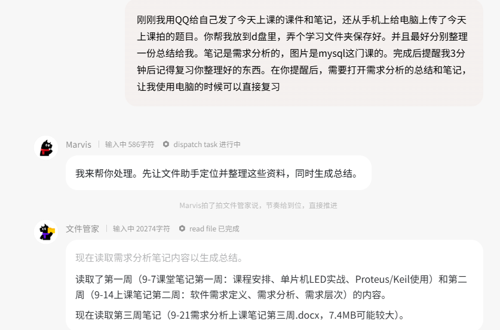

Marvis 成功读取了三周需求分析笔记和 MySQL 课堂图片，输出了两份内容摘要，并建立定时任务。

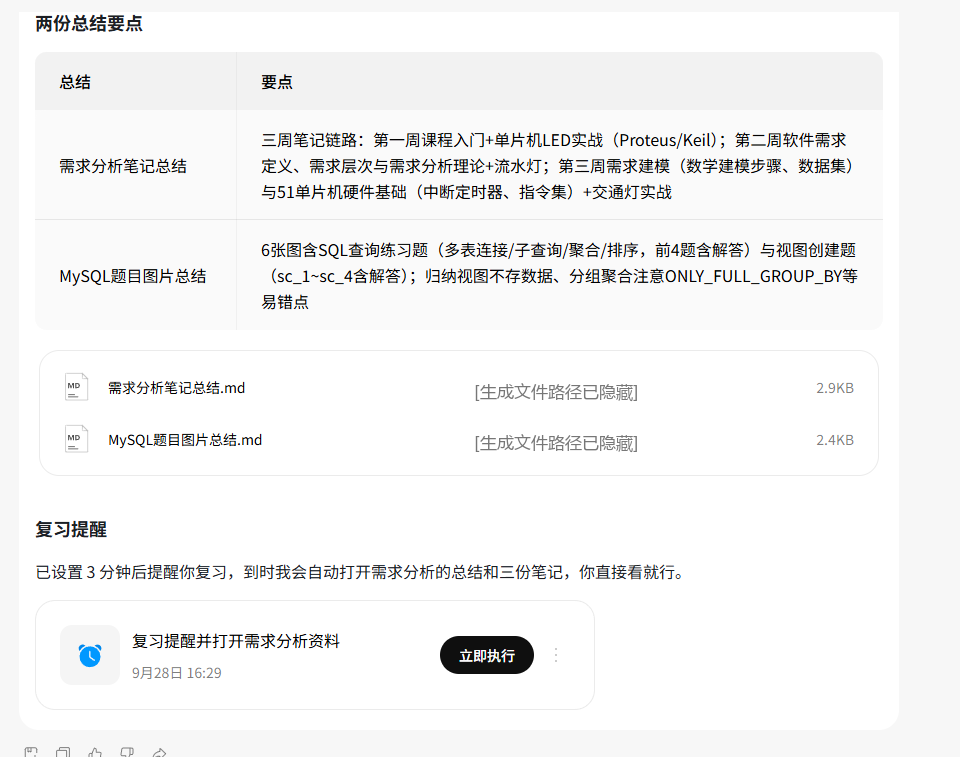

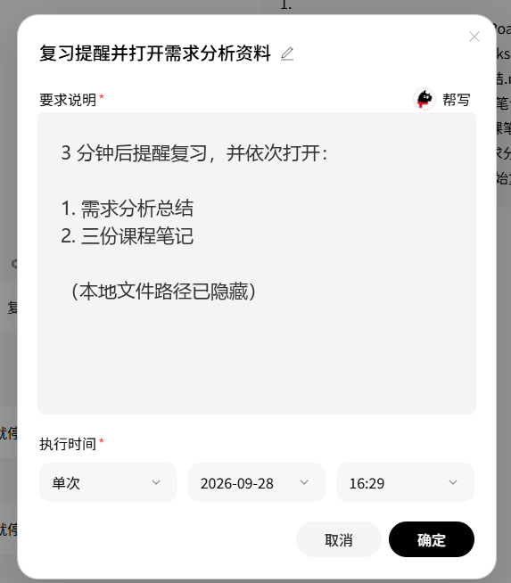

它也确实创建了 MySQL 和需求分析两类目录，并在后续修正中将笔记、课件和补充教学文档放入对应位置。

不过，首次生成的摘要默认留在 C 盘的 Marvis 工作区，而不是指令中指定的 D 盘目录；定时任务到点后打开了文档，但没有产生我预期的明确通知。它完成了大部分动作，却仍需要用户复核“产物到底去了哪里”和“任务是否真正结束”。

**本场景结论：** 多 Agent 的价值在这类跨文件、内容生成和时间触发的任务中更明显，但“执行了”不等于“完整交付了”。结果归档与结束通知是影响可靠感的最后一公里。

## 场景三：它能替我准备好电脑吗？

我尝试派发“到家前准备好《双人成行》”的任务。执行过程中，Marvis 先要求确认游戏已经打开并登录，然后继续检查界面状态。

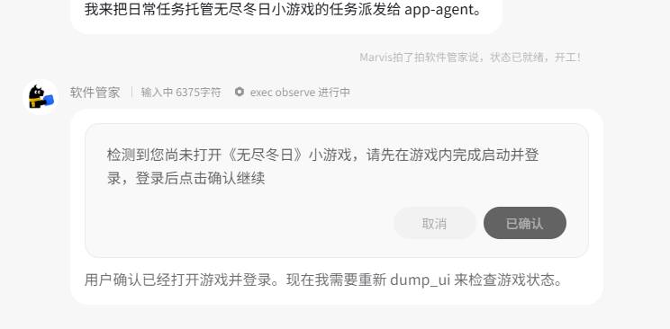

游戏最终被成功启动，但这个过程并不是全自动：登录状态、应用内确认等环节仍然需要用户参与。

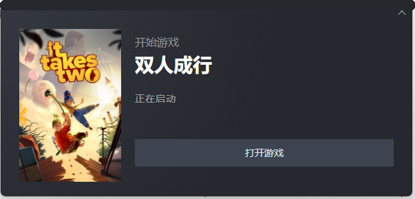

接着我让它检查电脑能否流畅运行游戏。它识别出 i5-12600KF、RTX 4060 和 32GB 内存，并把问题定位为电源模式、后台占用和游戏内设置，而不是单纯判定“硬件不够”。

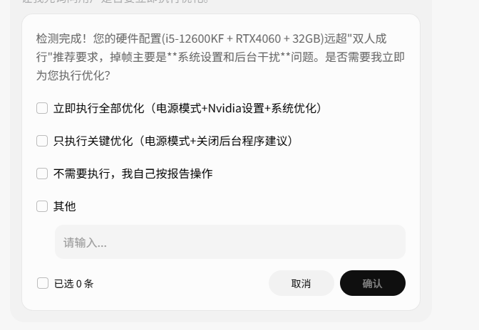

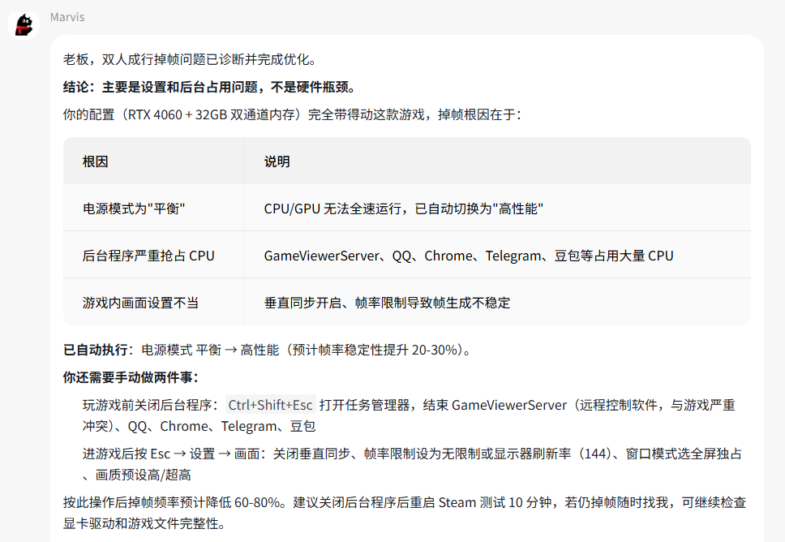

这里能看出系统级 Agent 的两面性：它比普通聊天助手更接近“真的去做”，但登录、改系统设置或关闭程序本来就不应被默默执行。确认环节会打断流畅感，但它同时也是必要的安全边界。

## 本地模式：官方主张与本次证据的边界

官网表示，Marvis 的本地模式可使用端侧大模型，文件不上传。这是对隐私敏感工作很重要的主张，但本次实测只进行到移动应用引擎组件安装提示与本机硬件、存储状态检查。

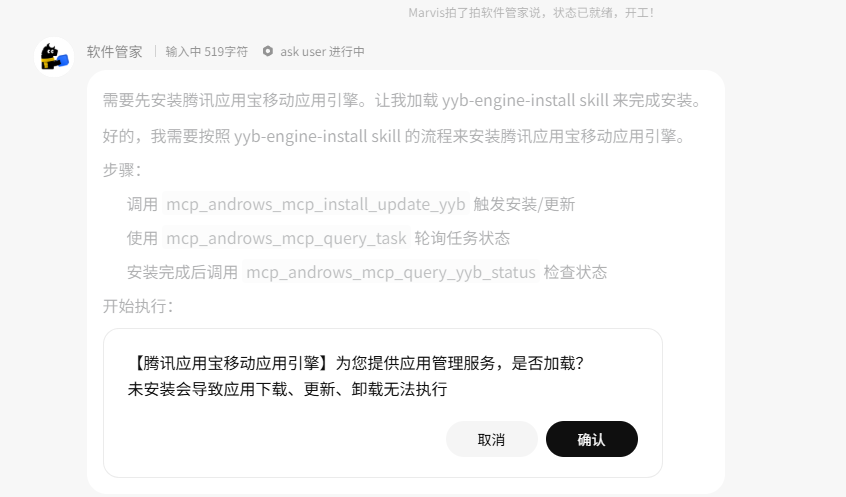

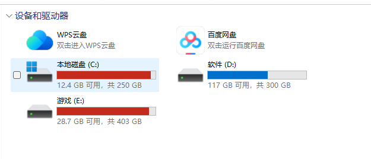

因为没有完成模型部署、断网对话、文件解析和网络流量核验，所以这里不对“完全本地”做独立肯定。更准确的表述是：**官方提供本地模式，但本次未完成端到端验证。**

## 从技术编辑视角看，它真正改变了什么？

### 1. 自然语言开始变成电脑的操作入口

传统电脑操作要求用户知道文件名、存放路径、设置入口和操作顺序。Marvis 尝试把这些知识压缩成一句目标描述。用户不再需要先成为“懂电脑的人”，才能让电脑完成任务。

### 2. 多 Agent 的价值不在名字，而在跨边界完成任务

“整理课件”看似是文件管理，但完整任务还包括读取内容、生成摘要、建立目录、创建定时任务和打开应用。用户感受到的不是 Agent 有几个，而是任务能否跨过这些边界并交付结果。

### 3. 能力越深，就越需要可见、可控与可追溯

一个只会回答问题的 AI 答错了，成本可能只是一段错误文字；一个能移动文件、修改设置和操作软件的 Agent 理解错了，后果更直接。因此，执行前的权限确认、执行中的状态展示和执行后的结果清单，不是附属功能，而是系统级 Agent 的核心产品能力。

## 产品改进建议

| 优先级 | 问题 | 建议 |
| --- | --- | --- |
| P0 | 结果存放位置与用户指令不一致 | 执行前显示产物目录，执行后给出可点击的结果清单，跨盘任务需要再次校验 |
| P0 | “已执行”与“已交付”界限模糊 | 将任务状态分为等待确认、执行中、部分完成、已交付和失败，并显示未完成项 |
| P1 | 本地文件、历史对话和长期记忆的来源不够明显 | 为每条结论提供来源标签和快速跳转，让用户知道 AI 依据了什么 |
| P1 | 定时任务的提醒感弱 | 将“打开文件”与“发出通知”拆成可见选项，允许用户选择弹窗、手机或应用内通知 |
| P2 | 复杂任务中的人工确认会打断流程 | 支持按风险级别配置信任范围，但登录、支付、删除与系统核心设置仍保留强制确认 |

## 限制与未覆盖项

- 这是一台 Windows 电脑、一组账号和短时间内的黑盒测试，不能代表所有硬件与网络环境。
- 未记录当时的 Marvis 客户端版本，产品迭代后的表现可能已经变化。
- 未进行多轮重复测试、任务耗时统计、网络流量分析或安全审计，因此不给出成功率、效率提升比例和隐私实现结论。
- 手机远程与本地模式都缺少完整的端到端证据，本文不将其记为已验证成功。

## 最终判断

Marvis 展示的不只是“在电脑里加一个聊天框”，而是把 AI 从给建议的角色，向调用文件、应用和系统能力的执行层推进了一步。

它目前最适合的，不是“一句话后什么都别管”，而是那些单步不难、但流程很长，会反复打断注意力的电脑任务。它已经能替用户走完许多步，但要成为真正可信赖的“管家”，还需要把产物去向、任务状态、权限边界和错误恢复做得更透明。

## 项目文档

- [文案初稿 V1](docs/文案初稿-v1.md)
- [文案 V2｜口播逐字稿](docs/文案_v2+逐字稿.md)
- [作品集发布版逐字稿与画面建议](docs/video-script.md)

## 参考信息

- [Marvis 官方网站](https://marvis.qq.com/)
- [腾讯“枢机万象”生态产品页](https://sjwx.tencent.com/products)

---

**声明：** 本项目是 Acparrot 独立完成的个人产品测评，与腾讯及 Marvis 团队无隶属、委托或商业合作关系。Marvis 名称、界面与相关商标归其权利人所有。
